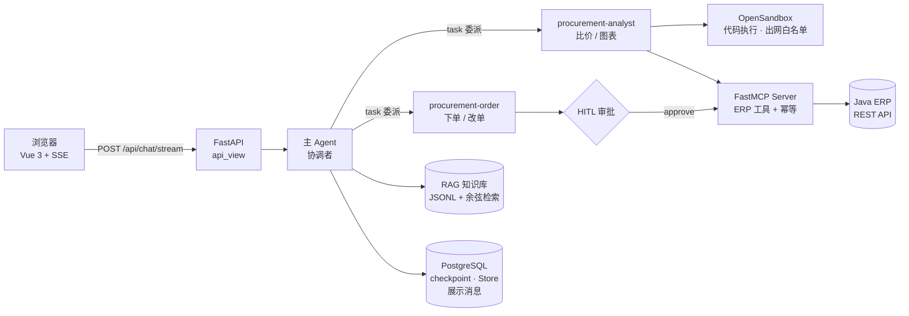

# 擎驰机车 · ERP 采购智能助手


> 面向机车零部件制造企业的采购 Agent：用自然语言完成**查料、比价、看库存、下单改单**，
> 写操作在人工审批后才落到 ERP，全链路可追溯、可重放、不重复下单。

一个真实业务里最难的不是"让模型会说话"，而是**让它在有副作用的系统里不出错**。
这个项目围绕这一点做工程：多 Agent 分工降低上下文噪声、MCP 把 ERP 能力工具化、
沙箱隔离代码执行与出网、订单写操作带幂等 + HITL 审批、RAG 兜住制度与领域知识、
评测集把"检索准不准 / 答得对不对"变成可回归的数字。

---

## 一、它解决什么

采购员每天要做的事：这个零件现在多少钱、哪家供应商更划算、库存够不够、
能不能插单、改个交期要走什么流程。这些动作分散在 ERP 的十几个页面里，
而且**每一步都可能是写操作**。

本项目的做法是把它们收敛成一个对话入口，同时用四道闸门防止 Agent 闯祸：

| 闸门 | 机制 | 代码位置 |
|---|---|---|
| 越权 | 主 Agent 不持有业务工具，只能委派子 Agent | `src/agent/main_agent.py` |
| 误写 | `order_create` / `order_update` 执行前强制人工审批 | `InterruptBanner.vue` + `chat.py` |
| 重复写 | MCP 层按业务指纹去重（剔除 orderNumber/orderTime） | `src/mcp_server/idempotency.py` |
| 越界执行 | 代码只在 OpenSandbox 里跑，出网默认拒绝 + 主机白名单 | `src/agent/backends/sandbox_setup.py` |

## 二、核心能力

| 能力 | 说明 |
|---|---|
| **多 Agent 协作** | 主 Agent 只做协调，`procurement-analyst` 负责比价/分析/出图，`procurement-order` 负责下单/改单/查询 |
| **MCP 工具桥接** | FastMCP Server 把 Java ERP 的 REST API 包装成供应商 / 零部件 / 订单 / 库存四组工具 |
| **RAG 知识检索** | 采购制度、零部件知识、供应商 QSDC 评估、库存策略；智谱 embedding + 本地向量库，百条级 <1ms |
| **HITL 审批** | 写操作前中断等待人工 approve/reject；字段缺失时也能中断等人补充 |
| **订单幂等** | 业务指纹去重 + 并发占位，重复审批 / 断线重连 / 重试都不会重复下单 |
| **代码沙箱** | 分析脚本在 OpenSandbox 内执行，默认拒绝出网，白名单按报价站点自动生成 |
| **流式前端** | Vue 3 + SSE，实时渲染 token、工具调用过程、审批卡片，支持深浅两套主题 |
| **评测集** | 13 条用例（10 正例 + 1 负例 + 2 路由），检索层 / 答案层可离线回归，失败退出码非零可直接接 CI |
| **多用户隔离** | 请求头 `X-User-Id` → `/memories/{user_id}/`，白名单校验防路径穿越 |

## 三、架构



一次下单请求的完整链路：

1. 前端带上 `X-User-Id` 发消息 → FastAPI 以 SSE 建立流；
2. 主 Agent 读用户偏好（`/memories/{user_id}/preferences.md`）→ 委派 `procurement-order`；
3. 子 Agent 校验字段完整性，缺字段就 `request_order_info` 中断等人补；
4. 数据齐了调 `order_create` → 触发 LangGraph `interrupt` → 前端弹审批卡片；
5. 用户 approve → 恢复执行 → MCP 先算业务指纹，命中则直接返回首次结果；
6. 结果落库（展示消息 + checkpoint），前端渲染成一段可回溯的对话。

## 四、快速开始

### 0. 依赖

- Python 3.12+、Node.js 18+
- PostgreSQL 16（docker compose 一键起）
- Docker Desktop：OpenSandbox Server（沙箱执行）与 MySQL（演示数据）
- 一个 **Java ERP 后端**（本项目通过 MCP 桥接它，仓库提供 `motorparts_db.sql` 演示数据）

### 1. 配置

```bash
cp .env.example .env
```

`.env` 里必填三项：

| 变量 | 用途 | 缺了会怎样 |
|---|---|---|
| `DEEPSEEK_API_KEY` | 主模型 / 摘要模型 / RAG 答案生成 | Agent 起不来 |
| `ZHIPU_API_KEY` | RAG embedding + `web_search` | 知识检索与联网搜索不可用 |
| `POSTGRES_URI` | checkpointer + Store + 展示消息 | Agent 起不来（Store 会降级到内存并告警） |

> 密钥只从 `src/agent/env_utils.py` 这一个入口读取，`.env` 已在 `.gitignore` 中。

### 2. 起 PostgreSQL

```bash
docker compose up -d
```

- 本地默认口令 `postgres/postgres`，与 `.env.example` 里的 `POSTGRES_URI` 一致，开箱即通；
- 生产环境用 `POSTGRES_PASSWORD` 覆盖（compose 读环境变量），并同步改 `.env` 里的 URI；
- 端口只绑 `127.0.0.1:5432`，数据库不对外网暴露。

### 3. 起 OpenSandbox（沙箱）

```bash
docker run --rm -d --name opensandbox-server -p 8080:8080 \
  opensandbox/opensandbox-server:latest
```

> ⚠️ **端口冲突**：OpenSandbox 默认 8080，Java ERP 常见默认端口也是 8080。
> 两者同机联调时改一个端口，并用 `SANDBOX_DOMAIN` 告诉后端：
> `SANDBOX_DOMAIN=http://127.0.0.1:8081`

### 4. 起 MCP Server（8000）

```bash
cd src && python -m mcp_server.server_main
```

必须在 `src/` 下以模块方式启动（内部使用 `mcp_server.*` 绝对导入）。
ERP 地址通过 `JAVA_API_BASE_URL` 覆盖，默认 `http://localhost:8080/api`。

### 5. 起 Web 后端 + 前端

```bash
python start_web.py            # 后端 8090 + 前端 3000，等 /health 通过再起前端
```

- 前端 <http://localhost:3000>
- API 文档 <http://localhost:8090/docs>
- 首次启动要建沙箱、加载 MCP 工具，**30–60 秒属正常**；`--backend-only` / `--frontend-only` 可单独起

## 五、目录结构

```
.
├── src/
│   ├── agent/                  # Agent 核心
│   │   ├── main_agent.py       #   主 Agent 工厂（10 阶段初始化）
│   │   ├── config.py           #   模型 / 沙箱 / 存储（checkpointer 延迟连接）
│   │   ├── env_utils.py        #   环境变量唯一入口
│   │   ├── middlewares/        #   上下文注入 · 记忆更新 · 技能同步/恢复 · 摘要
│   │   ├── subagents/configs/  #   子 Agent YAML（analyst / order）
│   │   ├── backends/           #   OpenSandbox 后端与出网白名单
│   │   └── tools/              #   web_search · knowledge_search · 图表合并 · HITL
│   ├── api_view/               # FastAPI（SSE 流式 / 历史 / 身份 / 连接池）
│   ├── mcp_server/             # FastMCP Server（ERP 工具 + 订单幂等）
│   ├── rag/                    # 知识库（embedding + JSONL 向量库 + 余弦检索）
│   ├── eval/                   # 评测用例与脚本
│   ├── skills/                 # 渐进式技能包（SKILL.md）· 按需加载
│   └── test/                   # 联调脚本
├── frontend/                   # Vue 3 + Vite（SSE / 审批卡片 / 工具过程）
├── tests/                      # 纯标准库单测（身份校验 / 订单幂等），CI 直接跑
├── docs/ARCHITECTURE.md        # 架构、模块、数据流详解
├── docs/EVALUATION.md          # 评测体系设计与用例说明
├── .github/workflows/ci.yml    # 编译 + ruff + 单测 + 前端构建
├── docker-compose.yml          # PostgreSQL 16
├── motorparts_db.sql           # 演示数据（MySQL dump，给 Java ERP 用，不是 PG）
└── start_web.py                # 一键启动
```

## 六、评测

```bash
python src/eval/run_eval.py                # 检索层 + 答案层
python src/eval/run_eval.py --skip-answer  # 只测检索层（不调 LLM，最快）
python src/eval/run_eval.py --case rag-004 # 单条用例
```

- **检索层**：期望来源是否出现在 top-k，且相关度高于阈值 —— 只依赖 embedding，改知识库后必须回归；
- **答案层**：把检索片段拼进 prompt 让模型回答，检查是否包含预期关键要点；
- **路由层**：需要完整 Agent 环境（沙箱 + MCP + PG），离线运行会标 `skipped`（在线模式尚未实现，见 `docs/EVALUATION.md`）。

报告落在 `src/eval/results/`，有失败时退出码非零。

## 七、几个值得展开的设计决策

1. **为什么主 Agent 不持有业务工具**：上下文越小越不容易跑偏；订单类写操作集中在一个子 Agent 上，
   挂审批只挂一处；子 Agent 可以独立配模型与中间件。
2. **为什么 checkpointer 延迟初始化**：原写法在模块顶层 `__enter__`，任何 `import` 都会建 PG 连接且永不释放。
   现在 `get_checkpointer()` 在真正创建 Agent 时才连库，import 无副作用，单测不需要数据库。
3. **为什么幂等指纹要剔除 `orderNumber` / `orderTime`**：这两个字段每次调用都会重新生成，
   不剔除的话同一笔业务请求每次指纹都不同，去重形同虚设——这是幂等实现里最容易踩的坑。
4. **为什么沙箱出网默认拒绝**：工具能读网页、能跑代码，一旦出网放开就是 SSRF 与数据外泄的通道。
   白名单由"基础清单 + 报价站点域名（从 `url_mapping.yaml` 自动提取）+ 环境变量"组成。
5. **为什么用 JSONL + numpy 而不是向量库**：百条级知识库暴力扫描 <1ms，引入 Chroma/Milvus 是纯运维负担。
   接口按"向量库"抽象（`add` / `search` / `count`），规模上去后替换实现即可。
6. **为什么 `X-User-Id` 要过白名单**：它会拼进 `/memories/{user_id}/preferences.md`，
   不校验就是明晃晃的路径穿越。当前没有登录体系，接入 JWT 后只需替换 `resolve_identity()`。

## 八、已知限制（诚实清单）

- **身份未鉴权**：`X-User-Id` 由客户端自报，没有签名。生产环境必须换成网关注入的可信身份或 JWT。
- **路由层评测未实现**：`--with-agent` 在线模式仍是 TODO，目前只有检索层与答案层可回归。
- **幂等库是 SQLite**：单进程有效，多副本部署需换成 PostgreSQL 唯一索引抢占（`idempotency.py` 里已写迁移方案）。
- **`motorparts_db.sql` 是 MySQL dump**：给 Java ERP 演示用，PostgreSQL 只存 Agent 状态，两者不要混。
- **未接入真实登录 / 组织架构**，会话归属只有 `user_id` 一个维度。

## 九、文档

- [架构与模块详解](docs/ARCHITECTURE.md) — 分层、数据流、每个模块的取舍
- [评测体系设计](docs/EVALUATION.md) — 分层评测的思路、用例设计原则、脚本逐段说明

## License

[MIT](LICENSE)
