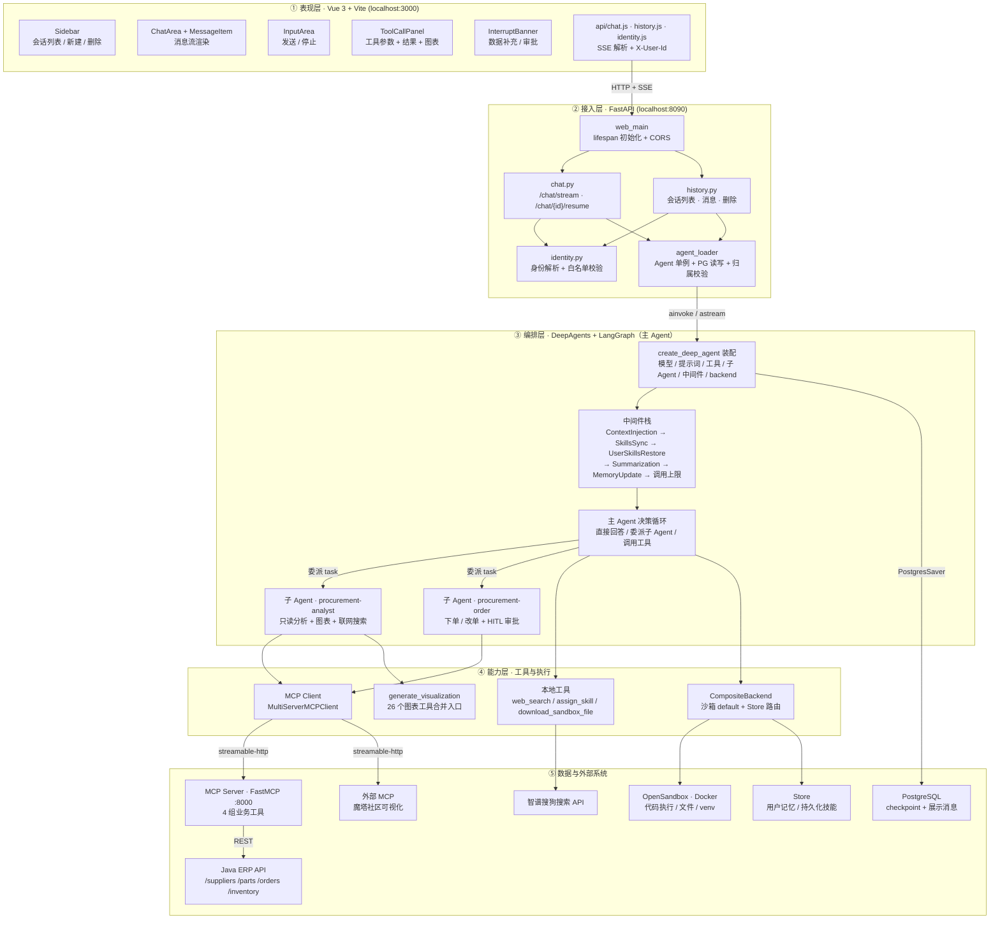
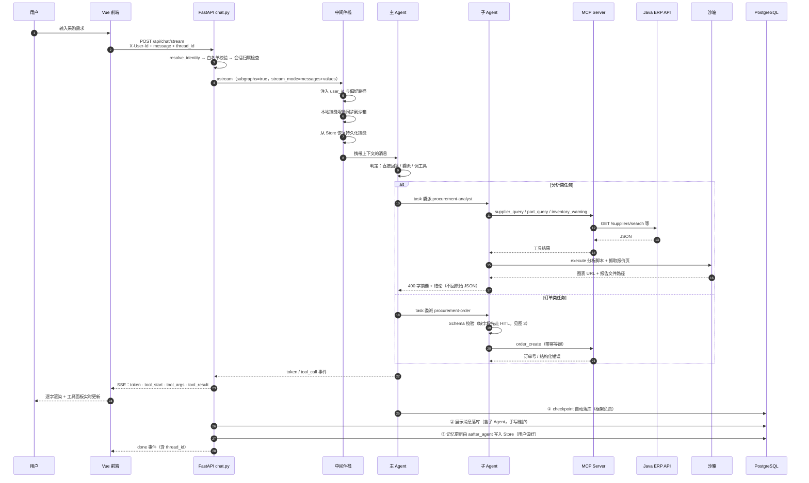
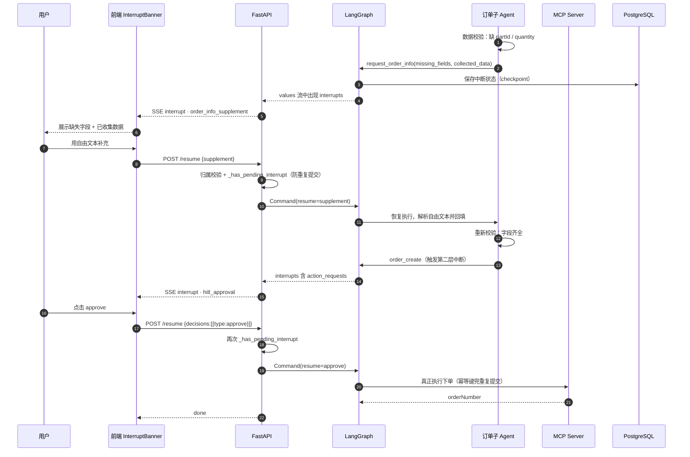
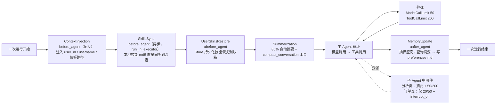
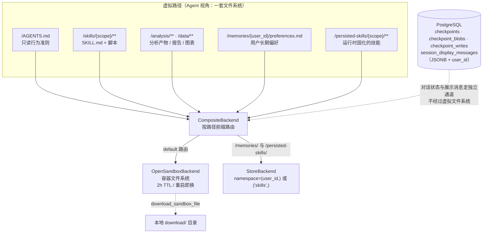
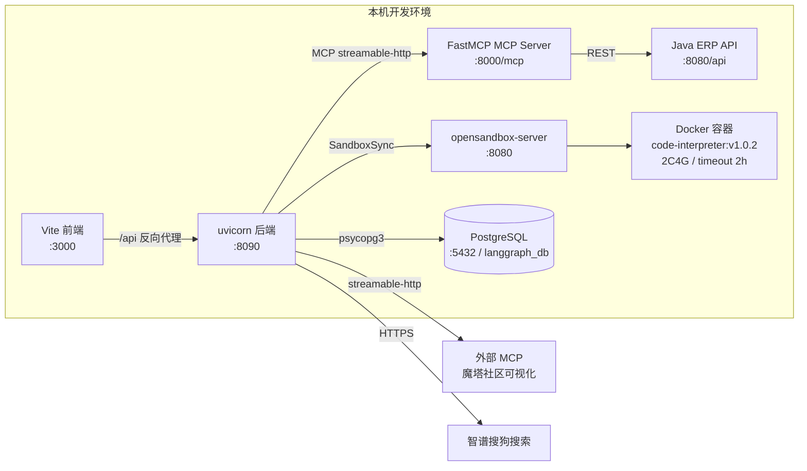
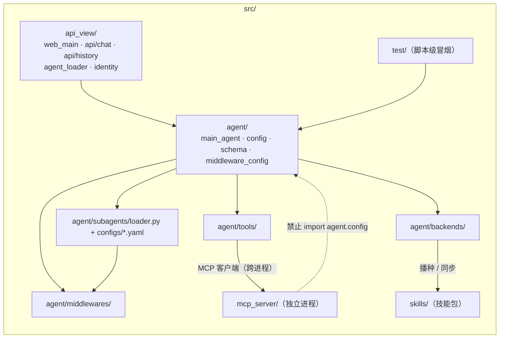

# 架构设计（Architecture）

> 本文是 [README](../README.md) 的展开：讲清分层、数据流，以及每个模块**为什么这么写**。
> 代码为准，文中摘录若与 `src/` 不一致，以代码为准。

系统性设计：**DeepAgents + LangGraph** 多 Agent 编排、MCP 工具协议、OpenSandbox 沙箱、
PostgreSQL 持久化、Vue 3 流式前端。

***

## 目录

- [项目概述](#项目概述)
- [整体架构](#整体架构)
- [详细架构图（Mermaid）](#详细架构图mermaid)
- [模块详解](#模块详解)
  - [1.](#1-srcagent--agent-核心) [`src/agent/`](#1-srcagent--agent-核心) [— Agent 核心](#1-srcagent--agent-核心)
  - [2.](#2-srcapi_view--api-视图层) [`src/api_view/`](#2-srcapi_view--api-视图层) [— API 视图层](#2-srcapi_view--api-视图层)
  - [3.](#3-srcmcp_server--mcp-server) [`src/mcp_server/`](#3-srcmcp_server--mcp-server) [— MCP Server](#3-srcmcp_server--mcp-server)
  - [4.](#4-srcskills--技能目录) [`src/skills/`](#4-srcskills--技能目录) [— 技能目录](#4-srcskills--技能目录)
  - [5.](#5-frontend--vue-3-前端) [`frontend/`](#5-frontend--vue-3-前端) [— Vue 3 前端](#5-frontend--vue-3-前端)
  - [6. 根目录文件](#6-根目录文件)
- [关键数据流](#关键数据流)
- [启动方式](#启动方式)
- [变更记录（批次 1：P0 正确性 / 安全 / 多用户 / 幂等）](#变更记录批次-1p0-正确性--安全--多用户--幂等)

***

## 项目概述  

项目亮点：opensandbox给deepAgent做了安全隔离

用户偏好记忆文件

使用yaml文件配置子Agent

skill是渐进式披露的，动态生成下载，分配的

QingchiERP 是一个面向机车零部件采购场景的智能对话助手，核心能力：

- **多 Agent 协作**：主 Agent（协调者）+ 两个子 Agent（采购分析、采购订单）
- **MCP 工具协议**：通过 MCP Server 桥接 Java 后端 REST API，提供 4 大业务工具分组
- **沙箱隔离执行**：基于 OpenSandbox（Docker）运行 Python 分析代码，安全隔离
- **长期记忆**：PostgreSQL 持久化对话状态（checkpoint）+ 展示消息 + 用户偏好
- **Human-in-the-Loop**：支持运行时中断，等待用户补充数据后恢复
- **流式输出**：SSE 推送 token / 工具调用 / 中断事件到前端

**技术栈**：Python 3.12 · LangGraph · DeepAgents · FastAPI · FastMCP · psycopg3 · OpenSandbox · Vue 3 · Vite

***

## 整体架构

```python
┌─────────────────────────────────────────────────────────────┐
│                  前端 Vue 3 (localhost:3000)                 │
│  Sidebar / ChatArea / InputArea / InterruptBanner / API      │
└────────────────────┬────────────────────────────────────────┘
                     │ HTTP + SSE (Vite proxy /api → :8090)
┌────────────────────▼────────────────────────────────────────┐
│              后端 FastAPI (localhost:8090)                    │
│  web_main.py → chat.py / history.py → AgentLoader (单例)     │
└────────────────────┬────────────────────────────────────────┘
                     │ agent.ainvoke / astream
┌────────────────────▼────────────────────────────────────────┐
│         主 Agent (DeepAgents + LangGraph StateGraph)         │
│  create_deep_agent 拼装：模型+提示词+工具+子Agent+中间件+后端  │
│  ├─ 子Agent: procurement-analyst / procurement-order        │
│  ├─ 中间件栈: 上下文注入/技能同步/记忆更新/摘要/限制          │
│  └─ CompositeBackend: 沙箱default + StoreBackend路由        │
└──┬──────────────┬───────────────┬──────────────┬───────────┘
   │              │               │              │
   ▼              ▼               ▼              ▼
┌──────┐  ┌────────────┐  ┌────────────┐  ┌──────────┐
│沙箱  │  │ MCP Client │  │ PostgreSQL │  │ Store    │
│Docker│  │→ erp-api   │  │ checkpoint │  │InMemory  │
│:8080 │  │→ analysis  │  │ + 展示消息  │  │(技能/记忆)│
└──────┘  └─────┬──────┘  └────────────┘  └──────────┘
                │
       ┌────────▼────────┐
       │ MCP Server      │
       │ FastMCP :8000   │
       │→ Java 后端 :8080│
       └─────────────────┘
```

***

## 详细架构图（Mermaid）

> 上一节的 ASCII 图给的是"一屏看懂"的骨架；本节把它拆成 7 张各司其职的图，**每张图都标注了"看什么"**，
> 便于新人按图读代码、也便于讲解项目时按顺序展开。
>
> 渲染说明：Typora / GitHub / Obsidian / VS Code（Markdown Preview Mermaid 插件）均可直接渲染。
> 若你的编辑器不支持，把 ```mermaid 代码块贴到 mermaid.live 即可看到结果。

### 图 1 · 五层系统架构（谁在调用谁）

**看什么**：从"用户输入"到"ERP 数据"要穿过哪五层；每一层的职责边界，以及**同一层内允许出现哪些组件**。



### 图 2 · 一次流式对话的完整时序（含子 Agent 与落库）

**看什么**：`astream` 的两种流（`messages` 出 token、`values` 出中断）、子 Agent 的结果为什么只回摘要、
以及**三处写库**分别写的是什么。



### 图 3 · HITL 双层中断与恢复（最容易出 bug 的地方）

**看什么**：两层中断（**数据补充** vs **操作审批**）如何共用 `interrupt()` + `Command(resume=...)` 机制；
以及 resume 前的 `_has_pending_interrupt` 校验为什么是幂等的关键。



### 图 4 · 中间件钩子与调用预算（谁在什么时候插一脚）

**看什么**：`before_agent` 链的顺序是有依赖的（先有 user_id，才能定位记忆路径；先同步技能，子 Agent 才能 `ls` 到）；
`MemoryUpdate` 必须在 `aafter_agent`——只有运行结束才有完整的「用户消息 + AI 摘要」可抽取。



### 图 5 · 虚拟文件系统与持久化路由（路径决定"活多久、归谁"）

**看什么**：Agent 眼里只有**一套**文件系统，但同一套路径背后是两种存储：
`/memories/`、`/persisted-skills/` 路由到 Store（跨会话、按用户隔离），其余留在沙箱（随容器销毁）。
这是"沙箱可以有生命周期、用户长期资产不能"的落地方式。



### 图 6 · 部署拓扑与端口

**看什么**：一共几个进程、谁监听哪个端口、哪些是本机 Docker、哪些是外部服务。



> ⚠️ **待确认的配置冲突**：`agent/config.py` 中沙箱服务配为 `http://127.0.0.1:8080`，
> 而 `mcp_server/server_config.py` 中 Java API 也是 `http://localhost:8080/api`——
> 同一台机器上两者不能同时占用 8080。图上按当前代码标注，实际部署时请确认其中之一改端口
> （建议沙箱服务换 8081 并同步 `SANDBOX_CONFIG.domain`），否则会出现"连上了但连错服务"的隐蔽故障。

### 图 7 · 代码模块依赖（改代码前先看这张）

**看什么**：`api_view` 只依赖 `agent` 的装配入口，不直接碰工具与后端；
`agent/tools` 才负责和 MCP 打交道；`mcp_server` 是**独立进程**，不能 import `agent.config`
（那会把 langchain/opensandbox 拉进 MCP 进程），所以它自带 `server_config.py`。



### 讲解顺序建议（面试/评审时按这个逻辑展开）

1. **图 1 讲分层与边界**：为什么要有 MCP 这一层（工具描述规范化 + 进程解耦）、为什么主 Agent 拿不到业务工具（权限收敛）。
2. **图 2 讲一次请求**：`messages`/`values` 双流、子 Agent 只回摘要（上下文治理）、三处落库（状态 / 展示 / 记忆）。
3. **图 4 讲中间件**：钩子顺序的依赖关系，顺带讲"记忆更新靠中间件而不是靠模型自觉"。
4. **图 5 讲持久化**：路径决定持久化语义——这是 backend 抽象最值钱的一点。
5. **图 3 讲 HITL**：两层中断、resume 的幂等保护（`_has_pending_interrupt` + 写操作幂等键）。
6. **图 6/7 讲部署与可维护性**：端口、进程边界、以及"为什么 MCP Server 不能 import agent.config"这种细节。

***

## 模块详解

### 1. `src/agent/` — Agent 核心

Agent 模块是项目核心，负责拼装 DeepAgents 智能体。包含 9 个子模块。

#### 1.1 `config.py` — 全局配置中心

**作用**：集中定义模型、沙箱、PostgreSQL、路径、Store 等所有配置。

**技术要点**：

- 两档模型：`MAIN_MODEL`（deepseek-v4-pro，temperature=0.3——编排类任务要稳定复现，不要创意）、`SUMMARY_MODEL`（flash，低温 0.2，负责摘要/记忆抽取等结构化小任务）；fallback 链路尚未接入，代码里不保留死变量
- 通过 `model_kwargs={"extra_body": {"thinking": {"type": "disabled"}}}` 关闭思考链
- `PostgresSaver.from_conn_string()` 创建 checkpointer 上下文，`setup()` 自动建表
- `InMemoryStore` 作为开发阶段的 StoreBackend（生产替换为持久 Store）

**重要代码**：

```python
# 模型三档配置
MAIN_MODEL = ChatOpenAI(
    model="deepseek-v4-pro", temperature=0.3,
    openai_api_key=DEEPSEEK_API_KEY, openai_api_base=DEEPSEEK_BASE_URL,
    max_tokens=16384,          # 单次输出上限（不是上下文窗口）
    model_kwargs={"extra_body": {"thinking": {"type": "disabled"}}}
)

# PostgreSQL checkpointer：延迟初始化，import 不产生数据库副作用
_CHECKPOINTER: Optional[PostgresSaver] = None

def get_checkpointer() -> PostgresSaver:
    global _CHECKPOINTER
    if _CHECKPOINTER is None:
        _CHECKPOINTER = PostgresSaver.from_conn_string(POSTGRES_URI).__enter__()
        _CHECKPOINTER.setup()      # 幂等建表
    return _CHECKPOINTER

# CompositeBackend 路由配置
SCOPE_MAP = {
    "main": "main",
    "procurement-analyst": "procurement",
    "procurement-order": "order",
}
```

#### 1.2 `main_agent.py` — Agent 入口（10 阶段初始化流水线）

**作用**：使用 `create_deep_agent` 组装 ERP 采购智能助手，采用 async graph factory 模式。

**技术要点**：

- **10 阶段初始化流水线**（日志按 `Phase x/10` 输出，含 1.4/1.5/3.6 三个子阶段）：沙箱配置 → AGENTS.md 上传 → CompositeBackend 分流 → MCP 工具加载 → 可视化工具合并 → 技能工具 → 工具池构建 → 子 Agent YAML 加载 → 子 Agent 中间件 → 工具名称解析 → 主 Agent 中间件栈 → `create_deep_agent()`
- **懒加载代理** **`_AgentProxy`**：兼容同步/异步两种初始化场景，访问属性时自动触发初始化
- **CompositeBackend 路由**：`/memories/` 和 `/persisted-skills/` 路由到 StoreBackend，其余留在沙箱
- **中间件栈**：ContextInjection → SkillsSync → UserSkillsRestore → Summarization → MemoryUpdate → ModelCallLimit(50) → ToolCallLimit(200)

**重要代码**：

```python
async def create_main_agent(config=None, *, sandbox_id=None):
    # Phase 1: 沙箱配置
    sandbox_backend = setup_sandbox(SANDBOX_CONFIG, sandbox_id=sandbox_id)

    # Phase 1.5: CompositeBackend 分流
    backend = lambda rt: CompositeBackend(
        default=sandbox_backend,
        routes={
            "/memories/": StoreBackend(runtime=rt,
                namespace=lambda rt: (getattr(rt.runtime.context, 'user_id', 'laoxiao'),)),
            "/persisted-skills/": StoreBackend(runtime=rt,
                namespace=lambda rt: SKILLS_STORE_NAMESPACE),
        },
    )

    # Phase 2: MCP 工具加载（erp-api + analysis 两个 MCP Server）
    all_mcp_tools, analyst_mcp_tools, order_mcp_tools, chart_mcp_tools = await load_mcp_tools()

    # Phase 9: 拼装 DeepAgent
    agent_graph = create_deep_agent(
        model=MAIN_MODEL,
        system_prompt=system_prompt,
        skills=["/skills/main/"],
        memory=[AGENTS_MD_FILENAME],
        tools=[web_search, assign_skill, download_sandbox_file],
        subagents=subagents,
        middleware=main_middleware,
        backend=backend,
        store=STORE,
        checkpointer=CHECKPOINTER,
        context_schema=ProcurementContext,
    )
    return agent_graph

# 懒加载代理
agent = _AgentProxy()

async def get_agent_async():
    """FastAPI lifespan 中调用此方法异步初始化"""
    global agent
    if isinstance(agent, _AgentProxy):
        if agent._is_initialized: return agent._agent
        agent._agent = await _create_agent()
        return agent._agent
    return agent
```

#### 1.3 `env_utils.py` — 环境变量加载

**作用**：从 `.env` 加载多个大模型 API Key 和 BaseURL。

**技术要点**：支持 OpenAI、DeepSeek、智谱、MiniMax、阿里、K2、Daytona 七家模型配置。

```python
from dotenv import load_dotenv
load_dotenv(override=True)

DEEPSEEK_API_KEY = os.getenv('DEEPSEEK_API_KEY')
DEEPSEEK_BASE_URL = os.getenv('DEEPSEEK_BASE_URL')
# ...其他模型
```

#### 1.4 `schema.py` — 数据结构定义

**作用**：定义运行时上下文、用户偏好、API 请求/响应模型、SSE 事件模型。

**技术要点**：

- `ProcurementContext`：dataclass，运行时上下文（user\_id、username）
- `UserPreferences`：用户偏好数据结构（输出格式、图表类型、货币、语言、近期供应商/查询）
- 7 个 Pydantic 模型：ChatRequest/Response、Message、Session、SSE 事件（Token/ToolStart/ToolArgs/ToolResult/Done/Error）

```python
@dataclass
class ProcurementContext:
    user_id: str
    username: str

class StreamTokenEvent(BaseModel):
    type: str = "token"
    content: str
    source: str = "main"  # main 或子代理名称
```

#### 1.5 `middleware_config.py` — 子 Agent 中间件工厂

**作用**：为两个子 Agent 创建定制中间件列表。

**技术要点**：

- 分析子 Agent：摘要工具中间件 + ModelCallLimit(50) + ToolCallLimit(200)
- 订单子 Agent：仅调用限制（ModelCallLimit(20) + ToolCallLimit(50)），因为订单操作简单

```python
def create_analyst_middleware(model, backend) -> list:
    return [
        create_summarization_tool_middleware(model, backend),
        ModelCallLimitMiddleware(run_limit=50),
        ToolCallLimitMiddleware(run_limit=200),
    ]
```

#### 1.6 `backends/` — 沙箱后端

**作用**：OpenSandbox 沙箱的初始化、文件播种、Python venv 创建。

**技术要点**：

- `sandbox_setup.py`：连接或创建沙箱（镜像 `code-interpreter:v1.0.2`），预创建 `/analysis/temp` 目录，上传技能文件（差异比对避免重复上传），创建 `/opt/skills-venv` 并预装 numpy/pandas/matplotlib/requests/beautifulsoup4
- `custom_opensandbox.py`：继承 `BaseSandbox`，实现 `execute`、`download_files`、`upload_files` 三方法
- 使用阿里云 PyPI 镜像加速（`https://mirrors.aliyun.com/pypi/simple/`）
- Sentinel 文件机制避免重复安装依赖

```python
def setup_sandbox(config, sandbox_id=None, image=None) -> OpenSandboxBackend:
    if not image:
        image = "sandbox-registry.cn-zhangjiakou.cr.aliyuncs.com/opensandbox/code-interpreter:v1.0.2"
    sandbox = SandboxSync.create(
        image,
        entrypoint=["/opt/opensandbox/code-interpreter.sh"],
        env={"PYTHON_VERSION": "3.11"},
        resource={"cpu": "2", "memory": "4Gi"},
        timeout=timedelta(hours=2),
        connection_config=config,
    )
    backend = OpenSandboxBackend(sandbox=sandbox)
    _ensure_dirs(backend)
    _seed_files(backend)      # 上传技能文件（差异比对）
    _create_venv(backend)     # 创建 venv + 预装依赖
    return backend
```

#### 1.7 `memory/` — 记忆与提示词

**作用**：系统提示词和 Agent 通用准则。

**技术要点**：

- `prompts.py`：主 Agent 系统提示词，定义协调者角色、委派规则、记忆管理
- `AGENTS.md`：**只读**通用准则，上传到沙箱 `/AGENTS.md`，包含对话生命周期、任务分配规则、记忆规范、安全边界
- 任务分配：分析类 → `procurement-analyst`，订单类 → `procurement-order`，通用知识 → `web_search`

#### 1.8 `middlewares/` — 5 个中间件

| 文件                       | 作用       | 技术要点                                                                       |
| ------------------------ | -------- | -------------------------------------------------------------------------- |
| `context_injection.py`   | 运行时上下文注入 | `before_agent` 钩子从 `runtime.context` 提取 user\_id/username，注入 SystemMessage |
| `skills_sync.py`         | 技能文件同步   | 扫描本地 `src/skills/`，哈希比对后上传新文件到沙箱，插入通知 SystemMessage                        |
| `user_skills_restore.py` | 用户技能恢复   | 从 StoreBackend 加载已持久化的技能到沙箱                                                |
| `memory_update.py`       | 自动记忆更新   | `aafter_agent` 钩子，LLM 提取供应商名/查询摘要，更新 `/memories/{user_id}/preferences.md`  |
| `tools_summarization.py` | 上下文摘要    | 调用 `create_summarization_tool_middleware` 长文本压缩                            |

```python
class ContextInjectionMiddleware(AgentMiddleware):
    def before_agent(self, state, runtime):
        ctx = getattr(runtime, "context", None)
        user_id = getattr(ctx, "user_id", None)
        notice = f"【系统上下文】\n当前用户 user_id: {user_id}\n..."
        return {"messages": [SystemMessage(content=notice)]}
```

#### 1.9 `subagents/` — 子 Agent 配置

**作用**：YAML 配置加载器，从 `configs/*.yaml` 读取子 Agent 定义。

**技术要点**：

- `loader.py`：`load_subagent_configs()` 读取 YAML 并校验必填字段（name/description/system\_prompt/tools）
- `resolve_subagent_tools()`：将 YAML 中的工具名字符串通过**子串匹配**解析为实际工具对象
- 两个子 Agent 配置：
  - `procurement_analyst.yaml`：采购分析专家，7 个业务工具 + generate\_visualization + web\_search
  - `procurement_order.yaml`：采购订单子 Agent

```python
def resolve_subagent_tools(configs, available_tools, extra_middleware=None):
    tool_index = {getattr(t, "name", None): t for t in available_tools}
    for config in configs:
        resolved_tools = []
        for pattern in config.get("tools", []):
            for tool_name, tool_obj in tool_index.items():
                if pattern in tool_name:  # 子串匹配
                    resolved_tools.append(tool_obj)
        # 去重 + 合并中间件
        subagent = {
            "name": config["name"],
            "description": config["description"],
            "system_prompt": config["system_prompt"],
            "tools": unique_tools,
        }
```

#### 1.10 `tools/` — Agent 工具集

| 文件                         | 作用                | 技术要点                                                                                                               |
| -------------------------- | ----------------- | ------------------------------------------------------------------------------------------------------------------ |
| `mcp_client.py`            | MCP 工具加载          | 连接两个 MCP Server（erp-api + analysis），按前缀分组（`supplier_`/`part_`/`inventory_` → 分析类，`order_` → 订单类，`generate_` → 图表类） |
| `chart_generator.py`       | 可视化工具合并           | 将 26 个 `generate_*` 工具合并为 1 个 `generate_visualization`，通过 `chart_type` 参数路由                                        |
| `web_search.py`            | 网络搜索              | 智谱搜狗 API，**懒加载** ZhipuAiClient 避免未配置 Key 时崩溃                                                                       |
| `hitl_tools.py`            | Human-in-the-Loop | `request_order_info` 通过 `langgraph.types.interrupt()` 暂停执行                                                         |
| `assign_skill.py`          | 技能分配              | 将 `/skills/main/` 下技能分配给指定 Agent 并持久化到 StoreBackend                                                                |
| `download_sandbox_file.py` | 沙箱文件下载            | 将沙箱文件下载到本地 `download/` 目录                                                                                          |

```python
# MCP 工具分组（mcp_client.py）—— 端点全部走环境变量，源码里不留任何第三方地址
#   ERP_MCP_URL / ERP_MCP_SERVER_NAME    业务 MCP（默认 http://127.0.0.1:8000/mcp）
#   CHART_MCP_URL / CHART_MCP_SERVER_NAME 图表 MCP；留空 = 不启用（Agent 照常启动，只是没图表工具）
ANALYST_TOOL_PREFIXES = ("supplier_", "part_", "inventory_")
ORDER_TOOL_PREFIXES = ("order_",)
CHART_TOOL_PREFIXES = ("generate_",)
```

> 图表能力依赖外部可视化 MCP Server：未配置 `CHART_MCP_URL` 时，`generate_visualization`
> 会返回"未启用图表服务"而不会让 Agent 启动失败。

***

### 2. `src/api_view/` — API 视图层

#### 2.1 `web_main.py` — FastAPI 主应用

**作用**：FastAPI 应用入口， lifespan 初始化 Agent，注册路由。

**技术要点**：

- `lifespan` 异步上下文管理器：启动时 `await agent_loader.initialize()`
- CORS 中间件：**显式白名单**（`localhost:3000/3001` + `CORS_EXTRA_ORIGINS`）。`allow_origins=["*"]` 与 `allow_credentials=True` 是浏览器规范下的无效组合，等于对所有站点开放跨域
- 路由：`/api/chat/*`（对话）+ `/api/history/*`（历史）+ `/health`（健康检查）
- 监听端口 8090

```python
@asynccontextmanager
async def lifespan(app: FastAPI):
    await agent_loader.initialize()
    yield

app = FastAPI(title=API_TITLE, lifespan=lifespan)
app.add_middleware(CORSMiddleware, allow_origins=CORS_ALLOWED_ORIGINS, allow_credentials=True, ...)
app.include_router(chat.router, prefix="/api", tags=["对话"])
app.include_router(history.router, prefix="/api", tags=["历史记录"])
```

#### 2.2 `web_config.py` — 后端配置

**作用**：PostgreSQL 连接、项目路径、API 元信息。

```python
POSTGRES_URI = "postgresql://postgres:<password>@localhost:5432/langgraph_db"
POSTGRES_DB_NAME = "langgraph_db"
PROJECT_DIR = Path(__file__).parent.parent
API_TITLE = "DeepAgent Chat API"
```

#### 2.3 `agent_loader.py` — Agent 加载器（单例）

**作用**：管理 Agent 生命周期 + 所有 PostgreSQL 数据库操作。

**技术要点**：

- **单例模式**：`__new__` 确保全局唯一实例
- **PostgreSQL 操作**（替代原 MongoDB）：
  - `_ensure_tables()`：幂等创建 `session_display_messages` 表（JSONB 字段）
  - `get_all_thread_ids()`：从 `checkpoints` 表查询所有会话 ID
  - `save_display_messages()` / `get_display_messages()`：完整展示消息存取（解决 checkpoint 丢失子代理消息问题）
  - `delete_session()`：删除会话所有相关数据（展示消息 + checkpoints + blobs + writes）
- **JSONB 自动解析**：psycopg3 将 JSONB 字段自动解析为 dict，无需 `json.loads`
- **超长字段截断**：`_truncate_message_fields` 防止单条消息过大（500KB 限制）

```python
def get_pg_connection():
    return psycopg.connect(POSTGRES_URI, row_factory=dict_row)

class AgentLoader:
    _instance: Optional['AgentLoader'] = None

    async def initialize(self):
        self._ensure_tables()
        from agent.main_agent import get_agent_async
        self._agent = await get_agent_async()
        self._initialized = True

    @staticmethod
    def _ensure_tables():
        with get_pg_connection() as conn:
            conn.execute("""
                CREATE TABLE IF NOT EXISTS session_display_messages (
                    id SERIAL PRIMARY KEY,
                    thread_id TEXT NOT NULL,
                    index INTEGER NOT NULL,
                    message JSONB NOT NULL,
                    updated_at TIMESTAMP NOT NULL DEFAULT NOW(),
                    UNIQUE(thread_id, index)
                )
            """)
            conn.commit()
```

#### 2.4 `api/chat.py` — 对话 API

**作用**：流式对话、中断恢复、会话状态查询。

**技术要点**：

- `streamChat` 端点：SSE 流式响应，解析 LangGraph astream 事件（token/tool\_call/tool\_result/interrupt）
- 调试日志：写入 `%TEMP%/deepagent_debug/stream_*.log`
- 子 Agent 名称提取：从 namespace 元组中解析 `tools:` 前缀
- UUID 过滤：过滤掉 token 中可能是 UUID 的无关标识符

#### 2.5 `api/history.py` — 历史记录 API

**作用**：会话列表、消息历史、删除会话。

**技术要点**：

- `get_message_role()`：兼容 LangChain 消息对象和 dict 格式
- `get_message_content()`：处理 content 可能是 str/list/dict 的情况
- 路由：`GET /api/history`（列表）、`GET /api/history/{thread_id}/messages`、`DELETE /api/history/{thread_id}`

***

### 3. `src/mcp_server/` — MCP Server

**作用**：基于 FastMCP 实现 MCP Server，桥接 Java 后端 REST API，为 Agent 提供业务工具。

#### 3.1 `server_main.py` — MCP Server 入口

**技术要点**：

- FastMCP 实例 + lifespan 管理 HTTP 客户端生命周期
- 注册 4 个工具分组：suppliers、parts、order、inventory
- `streamable-http` 传输协议，监听 `127.0.0.1:8000/mcp`

```python
mcp = FastMCP(
    name="Java-Backend-MCP-Server",
    instructions="调用 Java 后端 REST API 的工具集",
    version="1.0.0",
    lifespan=mcp_lifespan
)

register_supplier_tools(mcp)
register_parts_tools(mcp)
register_order_tools(mcp)
register_inventory_tools(mcp)

mcp.run(transport="streamable-http", host=MCP_HOST, port=MCP_PORT, path=MCP_PATH)
```

#### 3.2 `http_base.py` — HTTP 客户端生命周期

**技术要点**：lifespan 返回的字典通过 `ctx.request_context.lifespan_context` 传递给每个工具函数，避免全局变量。

```python
@asynccontextmanager
async def mcp_lifespan(server: FastMCP):
    http_client = httpx.AsyncClient(
        base_url=JAVA_API_BASE_URL,
        timeout=30.0,
        limits=httpx.Limits(max_keepalive_connections=20, max_connections=100)
    )
    yield {"http_client": http_client}
    await http_client.aclose()
```

#### 3.3 `server_config.py` — MCP 配置

```python
JAVA_API_BASE_URL = "http://localhost:8080/api"
MCP_HOST = "127.0.0.1"
MCP_PORT = 8000
MCP_PATH = "/mcp"
```

#### 3.4 `tools/` — 4 个业务工具分组

| 文件                   | 工具                                            | 说明                |
| -------------------- | --------------------------------------------- | ----------------- |
| `suppliers_tools.py` | `supplier_query`                              | 供应商模糊搜索           |
| `parts_tools.py`     | `part_query`/`part_search`/`part_by_supplier` | 零部件查询（分页/按名/按供应商） |
| `order_tools.py`     | `order_*`                                     | 订单创建/修改/查询        |
| `inventory_tools.py` | `inventory_warning`                           | 库存预警列表            |

工具通过 `ctx.request_context.lifespan_context.get("http_client")` 获取 HTTP 客户端调用 Java 后端。

```python
@mcp.tool(name=f"{GROUP_NAME}_query")
async def query_suppliers(name: str, ctx: Context) -> list:
    http_client = ctx.request_context.lifespan_context.get("http_client")
    response = await http_client.get("/suppliers/search", params=request_params)
    return result.get("data", [])
```

***

### 4. `src/skills/` — 技能目录

**作用**：沙箱内执行的技能包，每个技能包含 `SKILL.md`（操作手册）和可选脚本。

**结构**：

```python
src/skills/
├── main/                    # 主 Agent 技能
│   └── skill-management/    # 技能管理（下载/创建/分配）
│       ├── SKILL.md
│       └── scripts/download_skill.py
├── procurement/             # 采购分析技能
│   ├── procurement-analysis/SKILL.md  # 分析流程手册
│   ├── chart_params.md               # 26 种图表参数速查
│   └── web-scraper/scrape_page.py    # 网页抓取脚本
└── order/                   # 订单技能
```

**技术要点**：

- 启动时由 `sandbox_setup._seed_files()` 上传到沙箱 `/skills/`
- 运行时由 `SkillsSyncMiddleware` 增量同步
- 技能持久化通过 `assign_skill` 工具存入 StoreBackend `/persisted-skills/`

***

### 5. `frontend/` — Vue 3 前端

**技术栈**：Vue 3.4 + Vite 5.2 + markdown-it + highlight.js

#### 5.1 `src/App.vue` — 主组件

**作用**：聊天应用主布局，管理会话、消息、流式回调、中断恢复。

**技术要点**：

- 状态管理：sessions、currentThreadId、messages、isStreaming、interruptData
- `createStreamCallbacks()` 工厂函数：消除 handleSend/handleResume 重复代码
- 消息流混合展示：user → assistant 文本 → tool 调用 → assistant 文本
- AbortController 支持用户主动停止
- HITL 中断：`onInterrupt` 回调设置 interruptData，显示 InterruptBanner

```javascript
function createStreamCallbacks({ isResume = false } = {}) {
  return {
    onToken: (content, source) => { /* 追加到 assistant 消息 */ },
    onToolStart: (tool) => { /* 插入 tool 消息，状态 calling */ },
    onToolResult: (tool) => { /* 更新 tool 消息为 done */ },
    onInterrupt: (data) => { interruptData.value = data },
    onDone: (data) => { /* 清理 + 更新 thread_id */ },
    onError: (error) => { /* 显示错误消息 */ }
  }
}
```

#### 5.2 `src/components/` — 7 个组件

| 组件                     | 作用                               |
| ---------------------- | -------------------------------- |
| `Sidebar.vue`          | 侧边栏：会话列表、新建对话、删除，42px 圆角方形 logo  |
| `ChatArea.vue`         | 对话区域：消息列表 + 空状态（logo + 机车并排）     |
| `MessageItem.vue`      | 单条消息渲染（user/assistant/tool 三种角色） |
| `InputArea.vue`        | 输入框 + 发送/停止按钮 + 工具调用显示开关         |
| `InterruptBanner.vue`  | 中断横幅：数据补充 / HITL 审批              |
| `ToolCallPanel.vue`    | 工具调用详情面板（参数/结果/图片）               |
| `MarkdownRenderer.vue` | Markdown 渲染（代码高亮）                |

#### 5.3 `src/api/` — API 模块

**作用**：封装前后端通信。

**技术要点**：

- `chat.js`：`streamChat()` 使用 fetch + ReadableStream 接收 SSE，支持 AbortController 取消；`resumeChat()` 中断恢复
- `history.js`：会话列表/消息/删除/改标题
- Vite 代理：`/api` → `http://localhost:8090`

```javascript
// chat.js 流式请求
const response = await fetch(`${API_BASE}/stream`, {
  method: 'POST',
  headers: {'Content-Type': 'application/json'},
  body: JSON.stringify({message, thread_id: threadId}),
  signal: signal  // 支持取消
})
```

#### 5.4 `vite.config.js` — Vite 配置

```javascript
export default defineConfig({
  plugins: [vue()],
  server: {
    port: 3000,
    proxy: {
      '/api': {
        target: 'http://localhost:8090',
        changeOrigin: true
      }
    }
  }
})
```

***

### 6. 根目录文件

| 文件                  | 作用                                                              |
| ------------------- | --------------------------------------------------------------- |
| `start_web.py`      | **一键启动脚本**：同时启动后端（uvicorn :8090）和前端（vite :3000），等待后端健康检查通过后启动前端 |
| `test_pg_agent.py`  | PostgreSQL + Agent 端到端测试                                        |
| `pyproject.toml`    | 项目元信息（name=qingchi-erp-agent, Python>=3.12, 依赖与 ruff 配置）                        |
| `langgraph.json`    | LangGraph 配置（graph: `./src/agent/main_agent.py:agent`）          |
| `requirements.txt`  | Python 依赖                                                       |
| `.env`              | DeepSeek API Key 和 Base URL                                     |
| `motorparts_db.sql` | 数据库初始化 SQL                                                      |

**`start_web.py`** **关键逻辑**：

```python
def main():
    backend_proc = run_backend()  # uvicorn api_view.web_main:app --port 8090
    if not check_backend_ready(max_wait=180):  # 等待 /health 返回 healthy
        return
    frontend_proc = run_frontend()  # npm run dev (port 3000)
    # Ctrl+C 触发 cleanup() 终止两个进程
```

***

## 关键数据流

### 流式对话完整链路

```python
1. 用户输入 → InputArea.handleSend()
2. → chat.js streamChat() → POST /api/chat/stream
3. → chat.py 端点 → agent_loader.agent.astream(messages, config)
4. → LangGraph StateGraph 执行：
   a. ContextInjectionMiddleware 注入用户上下文
   b. SkillsSyncMiddleware 同步技能文件
   c. MAIN_MODEL 决策：直接回复 / 委派子 Agent / 调用工具
   d. 若委派子 Agent → task 工具 → 子 Agent 独立执行 → 返回结果
   e. 若调用 MCP 工具 → mcp_client → MCP Server :8000 → Java 后端 :8080
   f. MemoryUpdateMiddleware 自动更新用户偏好
5. → SSE 事件流推送回前端：
   - token 事件 → onToken 追加文本
   - tool_start/tool_args/tool_result → 工具调用面板
   - interrupt 事件 → InterruptBanner 显示
   - done 事件 → 完成
```

### HITL 中断恢复链路

```python
1. 子 Agent 调用 request_order_info(missing_fields, collected_data)
2. → langgraph.types.interrupt() 暂停执行，状态持久化到 PostgreSQL checkpoint
3. → SSE 推送 interrupt 事件 → 前端 InterruptBanner 显示
4. 用户补充数据 → resumeChat() → POST /api/chat/resume
5. → chat.py → agent.ainvoke(Command(resume=user_data), config)
6. → LangGraph 从 checkpoint 恢复，继续执行
```

### 数据持久化分层

| 数据类型             | 存储位置                                                            | 说明                         |
| ---------------- | --------------------------------------------------------------- | -------------------------- |
| 对话状态（checkpoint） | PostgreSQL `checkpoints`/`checkpoint_blobs`/`checkpoint_writes` | PostgresSaver 自动管理         |
| 展示消息             | PostgreSQL `session_display_messages`（JSONB）                    | AgentLoader 手动管理，解决子代理消息丢失 |
| 用户偏好             | StoreBackend `/memories/{user_id}/preferences.md`               | CompositeBackend 路由        |
| 持久化技能            | StoreBackend `/persisted-skills/`                               | assign\_skill 工具管理         |
| AGENTS.md        | 沙箱 `/AGENTS.md`（只读）                                             | 启动时上传                      |

***

## 启动方式

### 一键启动

```bash
python start_web.py
```

启动顺序：

1. 后端 uvicorn (:8090) → lifespan 初始化 Agent（沙箱+MCP+子Agent，30-60秒）
2. 健康检查通过后启动前端 vite (:3000)
3. 访问 `http://localhost:3000`

### 分步启动（调试用）

```bash
# 1. OpenSandbox Server（Docker，:8080）
# 确保 Docker Desktop 运行，opensandbox-server 已启动

# 2. MCP Server（:8000，必须在 src/ 下以模块方式启动——
#    server_main.py 用的是 mcp_server.* 绝对导入）
cd src
python -m mcp_server.server_main

# 3. Java 后端（:8080/api）
# 确保 Java ERP API 服务运行

# 4. 后端 FastAPI（:8090）—— 需要 PYTHONPATH 指向 src/
#    推荐直接 python start_web.py，它会设好 PYTHONPATH 并等 /health 通过
PYTHONPATH=src uvicorn api_view.web_main:app --reload --host 0.0.0.0 --port 8090

# 5. 前端 Vite（:3000）
cd frontend
npm run dev
```

### 环境依赖

| 依赖             | 版本    | 说明                       |
| -------------- | ----- | ------------------------ |
| Python         | 3.12+ | OpenSandbox 需要 3.10+     |
| Node.js        | 18+   | Vite 5 要求                |
| PostgreSQL     | 14+   | 数据库 `langgraph_db`       |
| Docker Desktop | 最新    | OpenSandbox 沙箱           |
| Java 后端        | -     | ERP REST API (:8080/api) |

### 关键配置文件

| 文件                        | 作用                                                 |
| ------------------------- | -------------------------------------------------- |
| `.env`（仅项目根这一个） | DeepSeek API Key                                   |
| `~/.sandbox.toml`         | OpenSandbox 配置（Windows 需 `resolve_internal=false`） |
| `langgraph.json`          | LangGraph graph 入口                                 |

***

*文档生成时间：2026-10-13*

---

# 变更记录

> 记录每一次改进的**问题 → 改动 → 行为变化 → 验证方式 → 回滚方式**。
> 目的是让"为什么这么写"和"出事怎么退"都有据可查，而不是只留在提交历史里。
